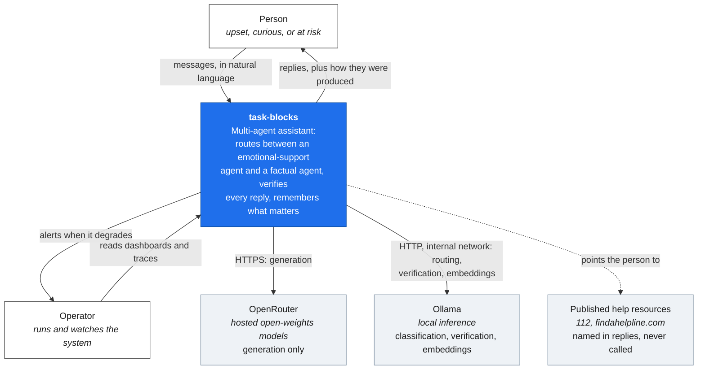
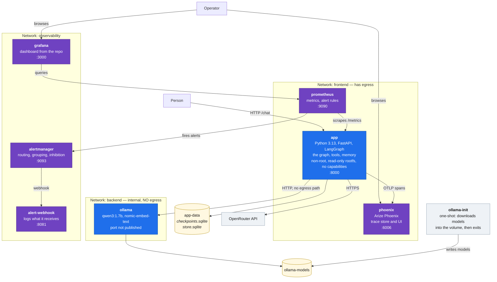
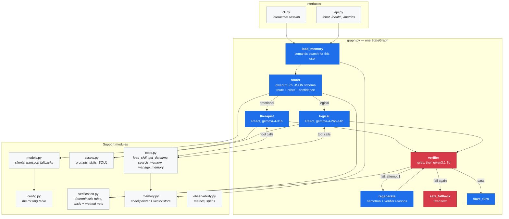
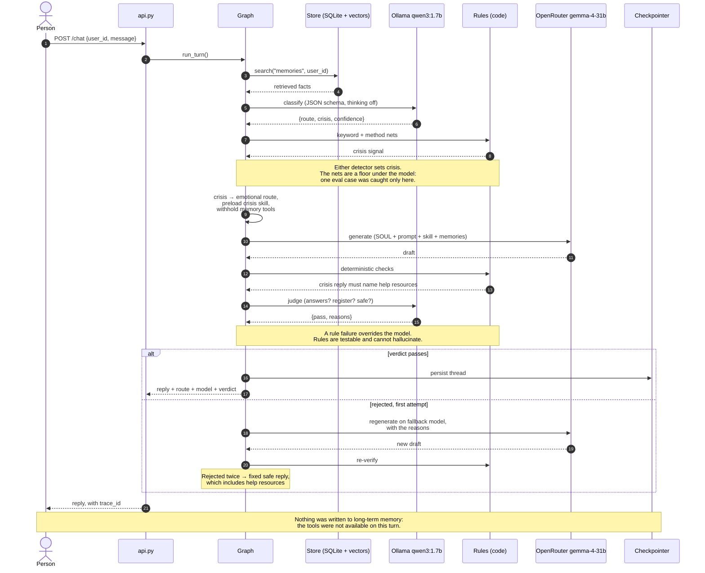

# Architecture

Four views: system context (C4 L1), containers (C4 L2), components inside the
app (C4 L3), and the sequence of one turn. Every node named here is an explicit
node of one `StateGraph` in
[`src/task_blocks/graph.py`](../src/task_blocks/graph.py), so the diagrams can
be checked against the code.

## Patterns

Router: classify once, then dispatch to a specialist. One agent with one prompt
covering both registers produces replies that are mediocre in both.

ReAct: each specialist loops between reasoning and tool calls until it has what
it needs.

Evaluator-optimizer (reflection): the verifier criticises the draft, and the
critique becomes input to a regeneration. The critic is a separate component
from the generator, and is partly deterministic, so it cannot approve its own
work.

Fallback chain at two levels: transport failures are handled inside the model
client, while quality failures are handled by the graph, since they need the
verifier's reasons. Both end at fixed text rather than an error.

Progressive disclosure: agents see skill names and descriptions, and bodies are
fetched on demand. The base prompt stays the same size as the skill library
grows.

## L1, system context

There are two inference providers, split by role rather than by availability.
Classification and verification run on every single request, so their marginal
cost dominates: locally it is zero, and the text never leaves the host, which
matters when the text may be someone describing a crisis. Generation is where
model quality shows, so it goes to a larger remote model. This split is the
cost-optimisation strategy.

## L2, containers

The networks are split this way because `ollama` holds the local models and
needs no internet once they are downloaded. It therefore sits on a network with
no route out, so that if a prompt injection ever persuaded a tool to talk to
it, there would be nowhere for data to go. The `app` service needs egress
because generation is remote. The monitoring stack never joins `backend`, since
nothing in it has reason to talk to the inference engine.

The `ollama-init` service exists because `ollama pull` is a client call: the
server performs the download. Asking the no-egress server to pull fails by
design, so the download happens in a short-lived container that does have
egress and writes into the shared volume. The serving instance then starts from
that volume with no route out.

## L3, components inside the app

The verification layer is drawn in red because the architecture is organised
around it. Everything else produces text; it decides whether text may be sent.

### State

One `TypedDict`, in [`state.py`](../src/task_blocks/state.py). The `messages`
field uses the `add_messages` reducer, and everything else is replaced by
whichever node writes it.

| Field | Written by | Purpose |
|---|---|---|
| `messages` | `save_turn`, `safe_fallback`, interfaces | the conversation |
| `route` | `router` | which specialist; also the verifier's register check |
| `crisis` | `router` | forces the emotional path, preloads the skill, withholds memory tools, enables a verifier rule |
| `confidence` | `router` | ambiguity signal, recorded as a histogram |
| `skill_hint` | `router` | which skill to preload |
| `draft` | specialists, `regenerate` | the candidate reply, not yet sent |
| `verdict` | `verifier` | pass or fail, reasons, and which stage decided |
| `attempts` | `regenerate` | terminates the loop |
| `model_used` | specialists, `regenerate`, `safe_fallback` | which model answered |
| `user_id`, `thread_id` | interfaces | memory scoping |
| `memories` | `load_memory` | retrieved long-term facts |

The `draft` field is separate from `messages` so that a reply becomes part of
the conversation only once it has passed. A rejected draft leaves no trace in
the thread.

## Sequence of one turn

A crisis turn, since it exercises every guard. This is the behaviour observed
in testing, where an explicit request to remember something was correctly not
stored.

## Reasoning behind the boundaries

The router is its own node rather than a function inside the specialist because
its decision is state the rest of the graph reads. The verifier checks register
against `route`, metrics are labelled by it, and the crisis flag changes which
tools exist. Hiding it inside a specialist would mean the specialist decides
whether it should have been called.

The verifier is a separate component rather than a longer system prompt because
a model asked to self-check in the same call has already committed to its
answer, and its self-assessment comes from the same process that produced the
mistake. A separate component, on a different model, with deterministic rules
that override it, can fail its input. In measurement it rejected 7 of 7
genuinely bad drafts and 0 of 4 acceptable ones.

Deterministic rules run first because they can be unit tested, cannot
hallucinate, and cost nothing. The model handles what rules cannot see, namely
whether the reply actually answers the question. Testing found a rule that had
never fired because of a regex bug, which supports this split: the untestable
half would have hidden it.

Regeneration switches model because a model that produced a bad draft at
temperature will likely produce a similar one again. Switching costs nothing
extra, since the fallback model is already configured for transport failures.

One retry is allowed because the loop must terminate, and a second failure is
evidence that the problem is not a sampling accident. Fixed text is the only
output that can be guaranteed safe.

Memory retrieval happens before routing because retrieval is cheap and local,
and a turn that turns out to be a crisis must not depend on a tool call for its
context. It also means the router sees the same recollections the specialists
do.
